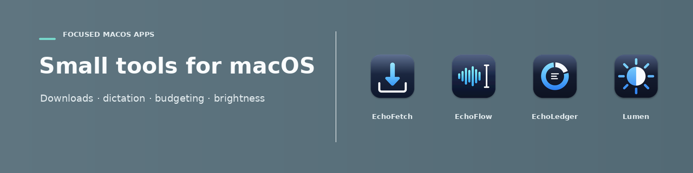

<!-- Profile README for github.com/9phfr6dsw4-dotcom (repo: 9phfr6dsw4-dotcom/9phfr6dsw4-dotcom, file: README.md) -->

 

<h3 align="center">Thoughtful software. Smoother workflows.</h3>

  Native Mac apps designed to help you get more done. 
  Clear interfaces. Practical features. Less friction.

 

Built for macOS · Designed with care · Made to be useful

<a href="https://github.com/9phfr6dsw4-dotcom?tab=repositories">Explore public repositories →</a>

